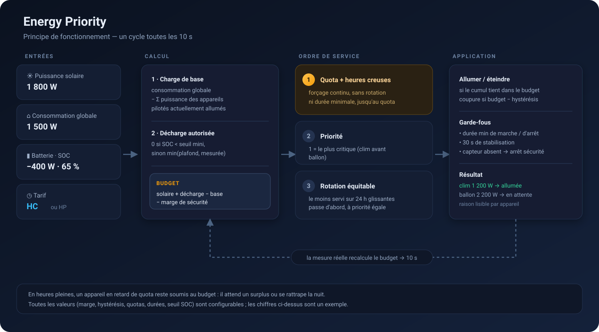
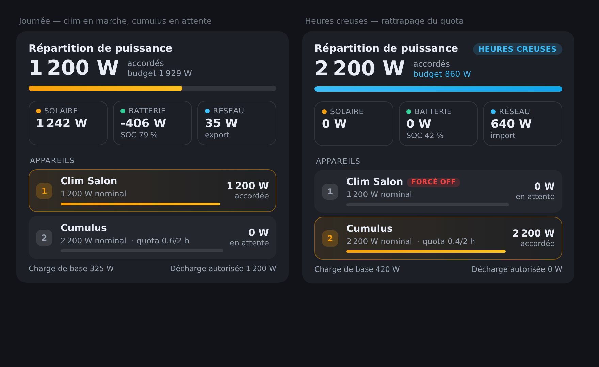

# Energy Priority

Contrôleur de priorité énergétique pour Home Assistant : il décide **quels appareils
consommateurs peuvent tourner**, en fonction du surplus solaire, de la batterie et du
tarif heures creuses.

## Principe

<p align="center">
  
</p>

À chaque cycle (10 s par défaut) :

```
charge_de_base = consommation_globale − Σ(puissance des appareils pilotés allumés)
decharge_batterie = min(plafond, décharge mesurée)   si batterie ≥ seuil, sinon 0
budget = solaire + decharge_batterie − charge_de_base − marge
```

Les appareils sont ensuite servis dans cet ordre :

1. **Quota non atteint + heures creuses** → forçage (le solaire n'est plus nécessaire,
   dans la limite de l'import réseau maximal si configuré).
2. **Priorité** croissante (1 = le plus critique).
3. **Temps de marche le plus faible sur 24 h glissantes** → rotation équitable à
   l'intérieur d'un même niveau de priorité.

En heures creuses, il n'y a **pas de rotation** : les appareils en retard de quota sont
servis en continu, par ordre d'urgence, et les durées minimales de marche/arrêt sont
ignorées pour eux (option `Ignorer les durées minimales...`), afin d'éviter des cycles
de 5 minutes qui ne chauffent rien.

Un appareil est coupé si le budget ne couvre plus son cumul, avec hystérésis pour
éviter le clignotement. Les durées minimales de marche et d'arrêt sont respectées.

## Installation

### HACS (dépôt personnalisé)

1. HACS → Intégrations → ⋮ → Dépôts personnalisés
2. URL `https://github.com/guillian77/ha-energy-priority`, catégorie « Integration »
3. Installer, puis redémarrer Home Assistant

### Manuelle

Copier `custom_components/energy_priority/` dans `/config/custom_components/` puis
redémarrer Home Assistant.

## Configuration

1. Paramètres → Appareils et services → Ajouter une intégration → **Energy Priority**
2. Renseigner les capteurs :

| Champ | Rôle |
|---|---|
| Puissance solaire | production photovoltaïque instantanée (W) |
| Consommation globale | puissance totale de la maison (W) |
| Puissance batterie | charge/décharge (W) |
| Pourcentage batterie | SOC (%) |
| Entité tarifaire | capteur dont l'état commence par `HC` en heures creuses |

3. Ajouter les appareils via **Configurer** sur l'intégration (ajout, modification,
   suppression), en précisant puissance nominale, priorité, durées minimales et quota.

Le formulaire de réglages est découpé en sections (Capteurs, Batterie, Budget et
régulation, Heures creuses, Sécurité) et chaque champ possède une description
affichée sous le libellé, pour éviter les mauvaises interprétations de signe ou
d'unité.

## Entités créées

Globales :

- `switch.energy_priority_pilotage_automatique` — coupe toute la régulation
- `sensor.energy_priority_puissance_disponible`
- `sensor.energy_priority_charge_de_base`
- `sensor.energy_priority_import_reseau_estime`
- `binary_sensor.energy_priority_heures_creuses`

Par appareil :

- `select` — mode `Auto` / `Forcé ON` / `Forcé OFF`
- `number` — priorité
- `number` — quota journalier (h, 0 = désactivé)
- `sensor` — puissance accordée (W)
- `sensor` — temps de marche sur 24 h glissantes
- `sensor` — décision courante + attribut `raison` (utile pour comprendre un choix)
- `binary_sensor` — quota non atteint (uniquement si un quota est défini)

## Carte de tableau de bord

L'intégration embarque sa propre carte : elle est enregistrée automatiquement au
chargement, aucune installation HACS supplémentaire n'est nécessaire.

<p align="center">
  
</p>

```yaml
type: custom:energy-priority-card
entity: sensor.energy_priority_repartition   # facultatif, détecté automatiquement
```

Elle affiche, en temps réel : le total accordé face au budget, le solaire, la
batterie (avec SOC) et le réseau, puis chaque appareil avec sa priorité, sa
puissance accordée, sa barre de charge, son avancement de quota et **le motif de la
décision** (« grâce manuelle (12 min restantes) », « puissance insuffisante (457 W
disponibles) », « forçage heures creuses, quota restant 0,3 h »…). Sans cette ligne,
un appareil maintenu allumé hors budget (grâce manuelle, temps minimum de marche)
semble incohérent avec les chiffres affichés.

Navigation : le titre ouvre la page de l'intégration (options, réglages globaux,
ajout/suppression d'appareils) ; un clic sur une ligne d'appareil ouvre sa page
d'appareil, où la priorité, le quota et le mode se modifient directement.

## Réglages conseillés

- **Marge** 100 à 200 W : évite de coller au plafond réel.
- **Hystérésis** 150 à 300 W : empêche l'oscillation quand un nuage passe.
- **Délai de stabilisation** 30 s : laisse le temps aux mesures de se recaler après
  une commutation.
- **Durée minimale de marche** : 180 s pour une clim (protection compresseur),
  1800 s pour un ballon d'eau chaude.
- **Quota** : 2 h/jour sur le ballon, avec forçage heures creuses activé.
- **Grâce après action manuelle** : 900 s par défaut. Si tu allumes ou coupes un
  appareil à la télécommande, au thermostat ou depuis le dashboard, l'intégration
  le laisse tranquille pendant ce délai au lieu de défaire ton geste au cycle
  suivant. 0 désactive la fonction.
- **Budget sur l'export mesuré** : si tu as un capteur de puissance réseau, active
  cette option. Le budget devient alors l'export réellement constaté, ce qui
  supprime toute surestimation (batterie qui ne suit pas, charge batterie, etc.).

## Précautions

- L'intégration suppose que la consommation globale **inclut** les appareils pilotés ;
  la charge de base est reconstituée en retirant leur puissance nominale.
- Si la puissance solaire ou la consommation globale devient indisponible, le
  comportement par défaut est de tout couper (`fail_safe_all_off`). Désactivable.
- La décharge batterie n'est jamais autorisée sous le seuil minimal de SOC : en
  dessous, la batterie sort du budget et seuls le solaire et le réseau alimentent
  les appareils pilotés (le reste de la maison continue de l'utiliser).
- **Une batterie en cours de charge n'est jamais comptée dans le budget.** Compter son
  plafond reviendrait à promettre une puissance qui n'existe pas : c'est le cas typique
  de la recharge en heures creuses, où cette erreur faisait tourner les appareils sur la
  réserve fraîchement constituée. Décocher « ne pas compter la batterie pendant sa
  charge » restaure l'ancien comportement, réservé aux onduleurs qui basculent
  instantanément de la charge à la décharge.
- Par défaut, seule la décharge réellement mesurée entre dans le budget. L'option
  « la batterie peut fournir sa puissance maximale à la demande » utilise à la place
  le plafond de décharge configuré.
- Aucune action n'est envoyée à un appareil dont l'entité est `unavailable`.
